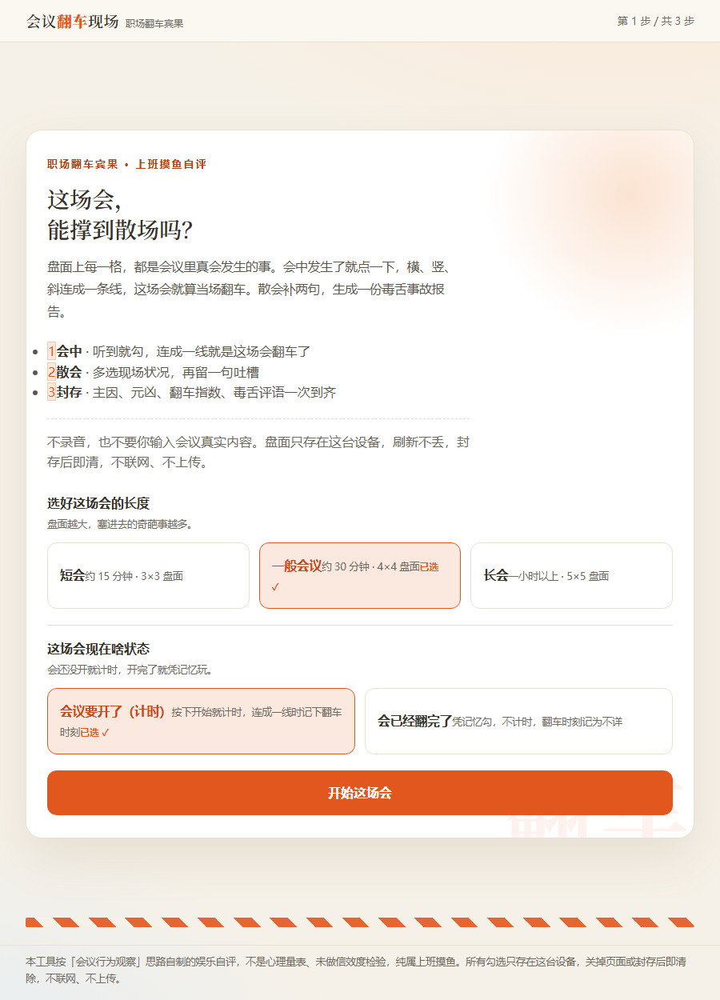

# 车祸大会 Bingo

> 这场会，能撑到散场吗？

[](./LICENSE) [](./assets/huoche-dahui-bingo.html) [](./SKILL.md)

**🔗 [在线体验 →](https://tomatoribs.github.io/huoche-dahui-bingo/)**（点开就玩 · 免安装 · 免注册）



一个 57 KB 的单文件 HTML，双击就开，断网也能玩，手机浏览器直接适配。页面自己先说明白：**不录音，也不要你输入会议真实内容。**

盘面每一格，都是会议里真会发生的事。会中发生了就点一下，横、竖、斜连成一条线，这场会就算当场翻车。散会补两句，生成一份毒舌事故报告。

**3 种盘面 · 双模式 · 四类损伤 · 0–100 翻车指数 + 四等评级 · 0 上传**

## 盘面 · 模式 · 损伤

盘面按会议长度选：**短会（约 15 分钟）3×3 · 一般会议（约 30 分钟）4×4 · 长会（一小时以上）5×5**——盘面越大，塞进去的荒唐事越多。

模式二选一：**会议要开了（计时）**——按下开始做计时，连成一线标记下翻车时刻；**会已经翻完了**——凭记忆勾，不计时，翻车时刻记为不详。

四类损伤实时计数，散会按翻车指数（0–100）定级，四等从轻到重：**轻微剐蹭 / 半翻不翻 / 彻底翻车 / 车毁人亡**。

| 损伤 | 典型现场 |
|---|---|
| 跑题 | 有人突然聊起昨晚的球赛；话题拐到了完全无关的部门八卦 |
| 空转 | 开场十分钟还在调试设备；关键决策被推到了「会后」 |
| 加码 | 会中又临时加了一个新任务；需求在会上一改再改 |
| 劝退 | 有人被当众点名批评；气氛冷到没人愿意先开口 |

## 功能亮点

- 💥 **连线即翻车**——横排、竖列或斜线连成一条线，当场弹「翻车」横幅 + 音效 + 高亮
- 📋 **散会复盘**——多选现场状况、留一句吐槽，主因、元凶、翻车指数、毒舌评语一次到齐
- 🖼 **一键存图**——2480×1520 PNG，也可复制 URL hash 分享
- 🔒 **本地优先**——勾选只存本机 localStorage，刷新不丢
- ⌨️ **键盘可玩**——盘面格子与全部选项为原生按钮（aria-pressed），尊重系统减弱动效

## 效果示例

```text
┌──────────────────────────────────────┐
│  车祸大会 · 事故报告                  │
├──────────────────────────────────────┤
│  命中格                              │
│   · 有人突然聊起昨晚的球赛           │
│   · 话题拐到了完全无关的部门八卦     │
│   · 开场十分钟还在调试设备           │
├──────────────────────────────────────┤
│  损伤  跑题 ██████  空转 ██          │
│  评级：彻底翻车                       │
│  主因：跑题        元凶：球赛        │
├──────────────────────────────────────┤
│  毒舌评语：全程没聊过正事，聊的都是  │
│  别人家的闲天和午饭吃啥。            │
└──────────────────────────────────────┘
```

> 格子与评语文案取自真实题库；翻车指数与评级由盘面勾选实时计算，以上为示例输出。

## 怎么用

1. 双击 `assets/huoche-dahui-bingo.html`（零外部依赖、不联网、不上传，手机可直接打开）。
2. 选盘面大小与模式，会中听到一句点一格。
3. 连成线就翻车；散会补两句现场状况，生成事故报告存图或分享。

## 隐私

不录音，也不要你输入会议真实内容。盘面只存在这台设备的 localStorage，刷新不丢；封存报告后即清，不联网、不上传。分享链接只带勾选结果与吐槽文本。

## 工位生存指南 · 六件套

| 现在的状况 | 玩哪个 | 花多久 |
|---|---|---|
| 下午有一场会 | **车祸大会 Bingo（你在这）** | 一场会 |
| 想知道到底有多想走 | [跑路指数测试](https://github.com/TomatoRibs/want-to-quit-index) | 6 分钟 |
| 想知道消耗的源头是谁 | [上司图鉴](https://github.com/TomatoRibs/shangsi-tujian) | 3 分钟 |
| 想给某个同事开庭 | [同事判刑书](https://github.com/TomatoRibs/workplace-verdict) | 3 分钟 |
| 只想先给环境做个体检 | [工位窒息指数](https://github.com/TomatoRibs/workplace-suffocation-index) | 30 秒 |
| 什么也不想干 | [摸鱼签筒](https://github.com/TomatoRibs/moyu-qiantong) | 摇一签 |

## 可二创

36 条格子文案在 `assets/huoche-dahui-bingo.html` 源码数组里，换成你们会上的高频惨案，宾果立刻本土化——「你们部门的会议实录」版。

## 为什么做这个

开会最折磨人的不是议题，是那些谁都看见了、却没人会写进纪要的荒唐瞬间。把它做成宾果，至少散会时不用再怀疑：白开的不止你一个人觉得。

## 装成 WorkBuddy 技能（可选）

```bash
bash scripts/install_local.sh .
```

WorkBuddy 是一个本地 AI 助手；装成技能后，一句话触发：「做一个 3×3 / 4×4 / 5×5 三种盘面、会中点格连线翻车的会议宾果网页」。

## 免责声明

本工具是思路自制的**娱乐自评**，不是心理量表、未做信效度检验，纯属上班摸鱼，也不构成对任何参会者的评价。所有勾选只存在这台设备，关掉页面或封存后即清除，不联网、不上传。

## 作者 · 许可证

番茄排骨 · [MIT](./LICENSE)

如果它陪你翻完了整场会，散会后点个 Star 再走。

> 下次这场会，试试只发一封邮件。
